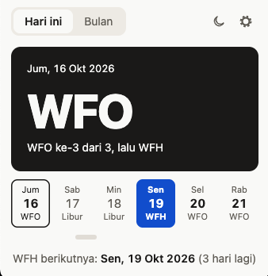
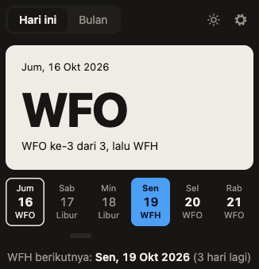
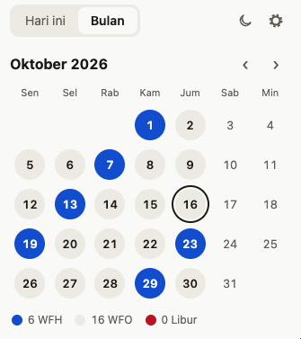
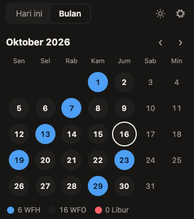
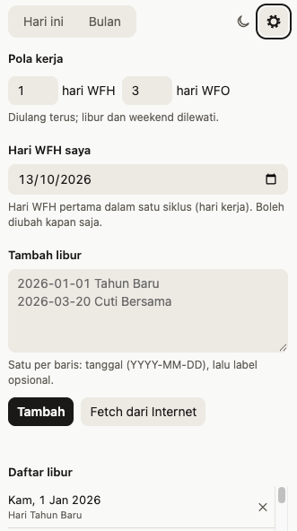

# Jadwal Indomie

Extension Chrome untuk melihat hari ini WFH atau WFO. Pola kerjanya bisa diatur (misalnya 1 hari WFH, 3 hari WFO), lalu diulang terus. Weekend dan hari libur dilewati, jadi siklusnya berhenti di hari libur dan lanjut lagi di hari kerja berikutnya.

<p>
  
  
</p>

## Fitur

### Hari ini

Kartu besar menampilkan status hari ini (WFH, WFO, atau Libur) dan posisinya dalam siklus, contohnya "WFO ke-3 dari 3, lalu WFH". Di bawahnya ada strip beberapa hari ke depan dan tanggal WFH berikutnya beserta hitung mundurnya.

### Bulan

Kalender satu bulan dengan warna per status: biru untuk WFH, abu-abu untuk WFO, merah untuk libur. Arahkan kursor ke tanggal untuk melihat nama liburnya. Di bawah kalender ada jumlah hari WFH, WFO, dan libur bulan itu. Tombol ‹ › pindah bulan, tombol "Hari ini" kembali ke bulan sekarang.

<p>
  
  
</p>

### Pengaturan

- **Bahasa.** Pilih bahasa tampilan: Bahasa Indonesia (default), English, 简体中文, atau 日本語. Pilihannya diingat.
- **Pola kerja.** Jumlah hari WFH dan WFO per siklus, masing-masing 1 sampai 20.
- **Hari WFH saya.** Pilih satu tanggal WFH (harus hari kerja). Hari lain dihitung dari tanggal ini, maju maupun mundur.
- **Tambah libur.** Tempel daftar libur, satu per baris dengan format `YYYY-MM-DD Label`. Labelnya opsional. Baris yang formatnya salah tetap ada di kolom supaya bisa diperbaiki.
- **Fetch dari Internet.** Mengambil libur nasional tahun ini dan tahun depan dari [APIHariLibur_V2](https://github.com/guangrei/APIHariLibur_V2) lalu memasukkannya ke kolom. Daftar ini belum disimpan: hapus dulu libur yang tidak diikuti kantor Anda, baru tekan Tambah.
- **Daftar libur.** Semua libur yang tersimpan, bisa dihapus satu per satu.



Kalau libur tahun yang sedang dilihat belum diisi, muncul peringatan karena jadwalnya bisa meleset.

### Mode gelap

Mengikuti tema sistem secara default. Tombol bulan/matahari di pojok kanan atas mengganti tema secara manual, dan pilihannya diingat.

## Pasang

1. Buka `chrome://extensions`.
2. Nyalakan **Developer mode**.
3. Klik **Load unpacked**, pilih folder ini.
4. Klik ikon extension, lalu tekan **Atur Jadwal WFH** untuk memilih hari WFH pertama.

Semua data (pola, tanggal WFH, daftar libur, tema) disimpan di browser Anda sendiri. Satu-satunya permintaan jaringan adalah tombol Fetch dari Internet.

## Tes

Logika jadwal ada di `schedule.js` dan diuji tanpa dependensi:

```sh
node test.mjs
```
